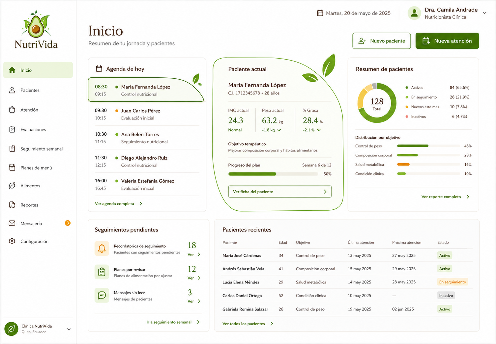
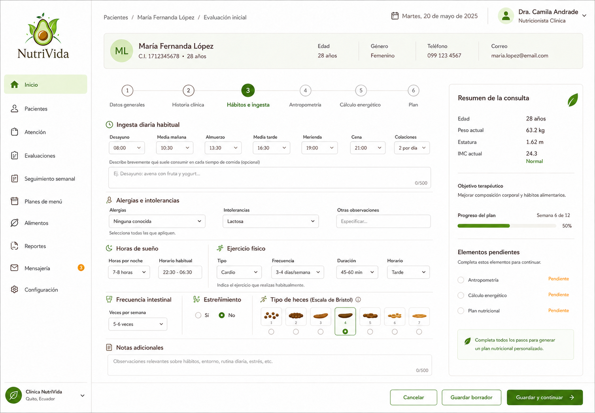

# NutriVida

Sistema profesional de historia clínica nutricional para Ecuador. Incluye pacientes, agenda, evaluación integral, diagnóstico nutricional PES, antropometría, cálculos energéticos, seguimientos, planificación de menús por porciones, catálogo alimentario versionado, reportes PDF, auditoría y preparación de envíos por correo/WhatsApp.

Empieza por el [instructivo de uso](docs/INSTRUCTIVO-DE-USO.md) y continúa con la [guía de registro módulo por módulo](docs/GUIA-DE-REGISTRO.md).

## Vista previa

La interfaz aplica una identidad editorial sobria, navegación clínica por etapas y componentes adaptables a escritorio y móvil.





> Las imágenes utilizan información demostrativa. El repositorio no debe contener expedientes ni archivos reales de pacientes.

## Recorrido principal

1. Registrar y asignar el paciente al nutricionista responsable.
2. Abrir una atención y completar evaluación, hábitos, antropometría y diagnóstico PES.
3. Calcular requerimientos energéticos con fórmula, actividad física y ETA trazables.
4. Construir el plan en el orden `Catálogo → Platos → Menú del paciente → Seguimiento`.
5. Generar el reporte PDF y preparar el envío consentido por correo o WhatsApp.

El administrador puede consultar toda la clínica y gestionar usuarios. Cada nutricionista únicamente puede acceder a los pacientes que tiene asignados; esta restricción se aplica en la API, no solo en la interfaz.

## Tecnología

- Frontend: Angular 22, TypeScript, HTML y SCSS.
- API: ASP.NET Core 10 y C#.
- Datos: SQL Server con Entity Framework Core y migraciones versionadas.
- Desarrollo: SQL Server local; producción: instancia SQL Server administrada.

La solución se abre en Visual Studio desde `backend/NutriVida.sln`. PyCharm no es necesario para este stack.

## Ejecutar en desarrollo

Requisitos: SDK .NET 10, Node.js 24 o compatible, npm y SQL Server. En este equipo el entorno de desarrollo utiliza la instancia predeterminada `Server=.`, evitando la inestabilidad observada en el lanzador de LocalDB.

Terminal 1:

```powershell
dotnet tool restore
dotnet run --project backend/src/NutriVida.Api --launch-profile http
```

Terminal 2:

```powershell
npm --prefix frontend install
npm --prefix frontend start
```

Abrir `http://localhost:4200`. La API escucha en `http://localhost:5158` y crea/aplica las migraciones a `NutriVidaClinicalDev` al iniciar en Development.

El servicio `SQL Server (MSSQLSERVER)` debe estar iniciado. La API también reintenta conexiones transitorias durante el arranque.

La documentación interactiva Swagger está disponible únicamente en desarrollo en `http://localhost:5158/swagger`; el documento OpenAPI se publica en `http://localhost:5158/openapi/v1.json`.

Accesos locales de demostración (contraseña común `NutriVida2026#`):

- `admin@nutrivida.local` — administrador clínico.
- `nutricionista@nutrivida.local` — nutricionista.

Estas credenciales existen solo en `Development`. Al iniciar la API local, `Development:ResetDemoCredentials` restaura ambas cuentas para que la demostración siempre pueda abrirse. Producción no ejecuta el sembrado ni acepta esta configuración.

## PDF, auditoría y catálogo autorizado

- `Reportes` genera un PDF clínico real en la API, filtrado por la clínica del usuario. Cada generación queda registrada.
- `Auditoría` es visible solo para Administrador y muestra cambios sin guardar contraseñas ni los valores clínicos completos.
- `Alimentos > Importar catálogo CSV` ofrece una plantilla, valida el archivo completo y conserva edición, referencia, usuario y huella SHA-256.
- El repositorio no incorpora el contenido del SMAE ni convierte datos demostrativos en oficiales. El cliente debe aportar un archivo autorizado.

### Probar un cambio de contraseña local

Para conservar un cambio de contraseña entre reinicios, cambia temporalmente `Development:ResetDemoCredentials` a `false` en `appsettings.Development.json`. Si después necesitas recuperar la cuenta, usa la herramienta local de mantenimiento:

```powershell
$env:NUTRIVIDA_CLAVE_TEMPORAL = 'UnaClaveTemporalSegura!'
dotnet run --project backend/herramientas/NutriVida.RestablecerClave -- admin@nutrivida.local --demo-ready
Remove-Item Env:NUTRIVIDA_CLAVE_TEMPORAL
```

La herramienta se conecta directamente a SQL Server y no debe publicarse junto con la aplicación web.

## Estructura

```text
backend/
  src/
    NutriVida.Domain/          Entidades separadas por módulo
    NutriVida.Application/     Reglas y casos de uso puros
    NutriVida.Infrastructure/  EF Core, SQL Server, migraciones y sembrado
    NutriVida.Api/
      Controladores/           API organizada por Pacientes, Atención, Evaluaciones y demás módulos
  tests/                       Pruebas unitarias y de integración
frontend/src/app/
  nucleo/                      Sesión JWT, API, configuración y paciente activo
  compartido/                  Iconos, notificaciones y componentes comunes
  modulos/<módulo>/
    paginas/                   Pantallas del módulo
    modelos/                   Tipos de datos del módulo
    acceso-datos/              Servicios que se comunican con la API
docs/                          Arquitectura, seguridad, fuentes, importación y QA
assets/brand/                  Referencia y marca generada desde el aguacate
```

La explicación detallada de cada carpeta, módulo y recorrido de datos está en [`docs/MODULOS.md`](docs/MODULOS.md). Para aprender el flujo con un paciente ficticio y datos listos para practicar, usa [`docs/GUIA-DE-REGISTRO.md`](docs/GUIA-DE-REGISTRO.md).

## Comandos de calidad

```powershell
dotnet test backend/NutriVida.sln
npm --prefix frontend test -- --watch=false
npm --prefix frontend run build
dotnet list backend/NutriVida.sln package --vulnerable --include-transitive
npm --prefix frontend audit --omit=dev
```

GitHub Actions ejecuta automáticamente compilación y pruebas en cada `push` y `pull request` mediante [`.github/workflows/quality.yml`](.github/workflows/quality.yml).

## Datos y producción

Los pacientes y alimentos incluidos son demostrativos. Ningún valor `EcuadorDemo` debe utilizarse para atención real. El cliente debe proporcionar una tabla ecuatoriana autorizada y, para SMAE, un archivo obtenido con su licencia. El formato está definido en `docs/DATA-IMPORT.md`.

Correo y WhatsApp validan consentimiento, enmascaran el destino en el historial, registran la preparación y abren `mailto:` o `wa.me` para que el profesional confirme el envío. Para automatizar envíos hay que elegir un proveedor aprobado, colocar credenciales fuera del repositorio y aprobar plantillas/políticas de privacidad.

Antes de producción se requiere revisión clínica de fórmulas, terminología y flujos; revisión jurídica de LOPDP y retención; proveedor de identidad JWT; respaldo; monitoreo; y pruebas con datos autorizados. El código ya exige HTTPS/HSTS, orígenes CORS reales y una clave JWT no demostrativa cuando `ASPNETCORE_ENVIRONMENT=Production`; usa `appsettings.Production.json.example` como guía y secretos mediante variables de entorno.

## Alcance de la publicación

Este repositorio es apto para demostración técnica y portafolio. No constituye por sí solo un sistema autorizado para tomar decisiones clínicas ni un despliegue productivo. Consulta [`docs/SECURITY.md`](docs/SECURITY.md) y [`docs/qa/VERIFICATION.md`](docs/qa/VERIFICATION.md) antes de alojarlo con datos reales.
